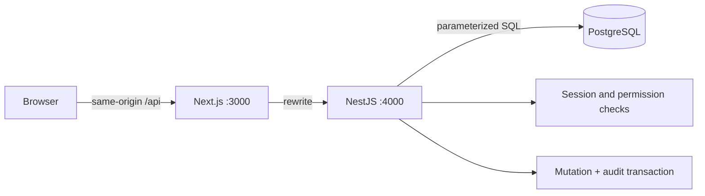

# Commons · Northstar workplace pilot

A working full-stack assessment prototype: **Next.js frontend, NestJS API, PostgreSQL database**. Fictional seed data only. All eight modules have persistent workflows or source-backed reads.

## Run with one command

Requires Docker with Compose:

```sh
docker compose up --build
```

Open http://localhost:3000. If those ports are occupied, use `DB_PORT=55433 API_HOST_PORT=4101 WEB_PORT=3100 WEB_ORIGIN=http://localhost:3100 docker compose up --build -d` and open http://localhost:3100. Select a demo persona and use `local-demo-change-me` for this local-only configuration. The database is seeded automatically on first API startup. Startup is idempotent and does not overwrite edited records. PostgreSQL data survives container restarts in `commons_data`.

For a shared deployment, set `DEMO_PASSWORD`, `POSTGRES_PASSWORD`, `WEB_ORIGIN` and `COOKIE_SECURE=true` in the hosting environment. The checked-in defaults are intentionally public **local demo values**, not production secrets. Never reuse them on a public server. See [deployment](docs/DEPLOYMENT.md).

| Persona     | Role                      | Useful demo                                                         |
| ----------- | ------------------------- | ------------------------------------------------------------------- |
| Maya Chen   | Employee, Product         | Post, recognize, edit own expertise, follow teams, express interest |
| Alex Morgan | Lead, Product             | Update a goal and staffing capacity; inspect team audit             |
| Jordan Lee  | Finance admin, Operations | Edit budgets, see financial Insights and audit entries              |
| Root Admin  | Root administrator        | Full cross-team access; manage every record, person and team        |
| Sam Rivera  | Employee, Operations      | Verify Product-private posts are absent                             |

## Scope and implementation plan

- [Scope and acceptance criteria](docs/SCOPE.md)
- [24-hour implementation plan and architecture decisions](docs/IMPLEMENTATION_PLAN.md)
- [AI build log](docs/AI_BUILD_LOG.md)
- [15-minute demo and code walkthrough](docs/WALKTHROUGH.md)
- [Deployment and submission checklist](docs/DEPLOYMENT.md)

## Why each module exists

| Module       | Implemented behavior and rationale                                                                                   |
| ------------ | -------------------------------------------------------------------------------------------------------------------- |
| Home         | Publish persistent updates and recognition; company/team visibility; Following filter makes shared work discoverable |
| People       | Search colleagues and self-listed skills; edit own expertise; recognize contributions without ratings                |
| Organization | Browse team mission/members and follow teams; makes structure and shared purpose visible                             |
| Goals        | Create goals, update progress with evidence; links progress to an accountable record                                 |
| Allocation   | Publish opportunities, plan available/needed hours, opt in/out; exposes capacity gaps without assigning people       |
| Budget       | Finance-only planned/actual spending and source notes; makes drivers traceable                                       |
| Insights     | Deterministic permission-filtered calculations with source records and as-of timestamps; avoids opaque AI numbers    |
| Compliance   | Transactional audit log with before/after details and scoped access; makes sensitive changes inspectable             |

## Architecture



The frontend stores no authoritative business data in localStorage. Next.js proxies API requests; NestJS authenticates an opaque HttpOnly cookie, applies visibility/role rules, and reads/writes PostgreSQL. Secrets stay on the server. The API URL is a server-side Next.js rewrite setting, established at build time.

The pilot uses typed domain records backed by JSONB for module-specific values. There is no ORM or generated schema layer. `apps/api/src/schema.ts` contains idempotent DDL and fictional seeds. Every SQL value is parameterized. This intentionally small model prioritizes connected workflows over enterprise configuration.

### Data model

| Table      | Purpose                                                                    |
| ---------- | -------------------------------------------------------------------------- |
| `teams`    | Team name and mission                                                      |
| `users`    | Fictional identity, team, role, owner-editable skills                      |
| `sessions` | Random opaque token, user and expiry                                       |
| `records`  | Kind, title, body, owner, team, visibility, module payload, timestamps     |
| `joins`    | Unique user/opportunity interest; no reporting-line or staffing assignment |
| `follows`  | Unique user/team feed preference                                           |
| `audit`    | Actor, action, source ID, team, before/after JSON and timestamp            |

Visibility is `company`, `team`, or `finance`. Root has full cross-team access. Tables also carry `archived_at` to support reversible deletion. Following never grants access. Finance admins can manage company planning and financial data but do not gain access to other teams' private feed posts. Audit visibility: own actions for employees, non-financial team actions plus own for leads, all actions for finance and root.

## Local development

Node.js 22 and PostgreSQL 16+ recommended. For a fresh checkout:

```sh
npm ci
cp .env.example .env
docker compose up -d db
npm run dev
```

`npm run dev` loads `.env` and optional `.env.development` (existing environment values take precedence), checks PostgreSQL connectivity, and starts both NestJS and Next.js with file watching. Ctrl+C stops both apps. The default development ports are 3000/4000; change `WEB_PORT`, `API_PORT`, `WEB_ORIGIN` and `API_URL` together if needed. `DATABASE_URL` must match the published PostgreSQL port.

On the current development machine, an ignored `.env.development` is initialized only if absent, using the verified database on port 55433 and development frontend/API ports 3102/4102. The Docker application remains on port 3100. Both use the same fictional pilot database.

## Complete record lifecycle and root administration

- Posts, recognition, goals, opportunities and budgets support create, read, edit, archive and restore. Forms expose all editable fields, including titles, details, team/visibility, goal targets/evidence, allocation hours, and financial values/source notes.
- **Archive is the delete operation:** data remains recoverable and audit history is preserved. Archived records are hidden by default and excluded from Insights. Enable **Include archived records** to inspect and restore entries you manage.
- Authors can edit/archive their posts and recognition; leads manage their team's plans; finance manages budgets and planning. **Root Admin** bypasses role/team restrictions across records and can create/edit/archive/restore people and teams.
- Root may change roles, team membership and profile fields. Role/team changes revoke other users' sessions; archived people cannot sign in. The active root account cannot archive or demote itself. Teams with active people or records must have those dependencies reassigned or archived first.
- Every successful mutation shows an in-app success notification. These are confirmation toasts, not email/SMS delivery or fraud alerts.
- Mutations, including follows and directory changes, write audit entries in the same PostgreSQL transaction. Audit entries remain read-only; root access does not erase history.

## Validation

```sh
npm run lint
npm test
npm run build
# With API and database running:
TEST_API_URL=http://localhost:4102 node --env-file=.env scripts/integration.mjs
TEST_API_URL=http://localhost:4102 node --env-file=.env scripts/crud-integration.mjs
```

Policy tests cover visibility, cross-team management and financial validation. HTTP integration checks use real PostgreSQL: authentication, persistent writes, direct-record authorization, budget restrictions, evidence links, opt-in, own profile edits, follows, audit visibility and logout. Integration checks create fictional test records, archive them, retain their audit records, and restore changed seed values. The CRUD suite also injects a temporary failing audit trigger to prove transaction rollback, removing it in a finally block. Run against a disposable database, not a customer deployment.

GitHub Actions runs lint, unit tests, production builds and PostgreSQL integration checks on every push and pull request. It becomes active when the repository is pushed to GitHub.

## Assumptions and limits

One company, five seeded users, four roles, no real personal data. The supplied brief references a separate visual concept pack that was not supplied. The UI is an original interpretation. AI answers are explicitly deterministic, not LLM-backed. Recognition celebrates contribution, never proficiency. All financial amounts are USD. Progress is owner-reported; capacity is manually entered and independent of expressions of interest.

This is a pilot, not a production security claim. Before production: SSO, tenant isolation, per-resource schema constraints, versioned migrations, SQL-level pagination/filtering, login throttling, audit tamper resistance, monitoring, backup/restore validation, granular budget roles, optimistic locking and broader accessibility checks. No deployment or public repository URL is claimed until actually provisioned and verified.

## Agent skills

Matt Pocock’s published engineering and productivity skills are installed locally in `.agents/skills/`. See [usage, setup, and provenance](docs/SKILLS.md). Open Commons as your Codex project to discover them.
